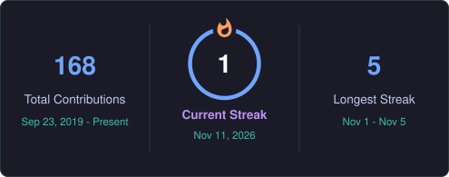

# Hi, I'm Azhar 👋

### Process Mining Engineer (Celonis) • Data Engineer

*Building scalable process mining data models, high-volume ETL pipelines, and applied operational intelligence workflows.*

  
  

---

### 🚀 Projects

#### **[O2C_AI](https://github.com/Az-har/O2C_AI)**
Enterprise Order-to-Cash (O2C) delay prediction and process intelligence engine. Combines Gradient Boosting models on SAP transactional data with semantic contract RAG and an interactive Streamlit workbench to classify delivery risks and identify operational bottlenecks.  
`Celonis / SAP` • `Python` • `PQL & Process Mining` • `Gradient Boosting` • `RAG`

#### **[enterprise-synth-data](https://github.com/Az-har/enterprise-synth-data)**
Memory-efficient (< 4GB RAM) synthetic data generation and format-preserving referential data masking studio with an embedded 42,000+ table SAP data dictionary (`BKPF`, `BSEG`, `VBAK`, `VBAP`).  
`Python` • `SAP Schema` • `Data Masking` • `SQLite` • `ETL`

#### **[automotive-analytics-project](https://github.com/Az-har/automotive-analytics-project)**
Automotive pricing and market analysis pipeline. Built an ETL workflow in Python and SQL to ingest and clean automotive listing datasets, designed dimensional data models with dbt, and analyzed depreciation trends in Power BI.  
`dbt` • `SQL` • `Python` • `Power BI`

#### **[youtube-summarizer-audiobook](https://github.com/Az-har/youtube-summarizer-audiobook)**
Local multi-agent pipeline that downloads YouTube videos or playlists, transcribes speech with GPU-accelerated Whisper, runs an LLM editorial evaluation loop, and produces mastered audiobooks and Notion digests.  
`Whisper large-v3` • `AMD Vulkan` • `Ollama` • `FFmpeg`

#### **[SuperCenter](https://github.com/Az-har/SuperCenter)**
Offline-first Android personal savings and habit tracker built with Material 3, local SQLite/Room persistence, automatic backups, and home-screen Glance widgets.  
`Android` • `Kotlin & Java` • `SQLite` • `Material 3`

#### **[scratchpad-python](https://github.com/Az-har/scratchpad-python)**
Curated collection of standalone Python scripts, including a real-time 3D spinning donut terminal animation, an image-to-ASCII converter, and CLI utilities.  
`Python` • `Algorithms` • `CLI Tools`

---

### 🛠️ Technical Skills

- **Process Mining**: Celonis, Object-Centric Process Mining (OCPM), Case-Centric Process Mining (CCPM), Process Optimization
- **Celonis Engineering**: Celonis PQL, Celonis Data Models, KPI Development, Celonis ML Workbench
- **Data Engineering**: SQL, ETL Pipelines, Delta Loading / Incremental Processing, Data Modeling, dbt, Vertica SQL, Snowflake, PostgreSQL
- **Operational Engineering**: Root Cause Analysis (RCA), Incident Debugging, Backend Support, Production Monitoring
- **Additional Tools & Languages**: Python (Pandas, NumPy), Power BI, Git

---

  

